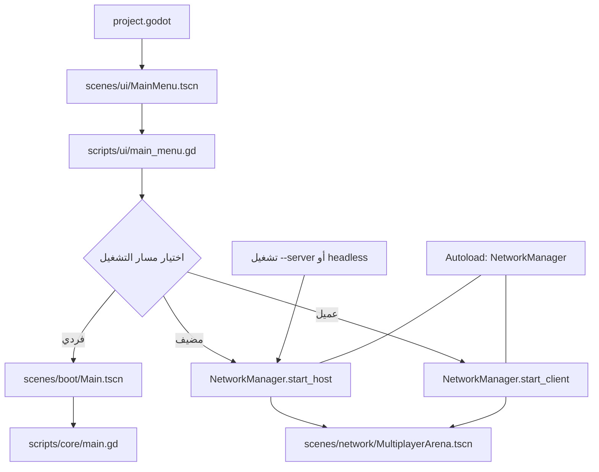
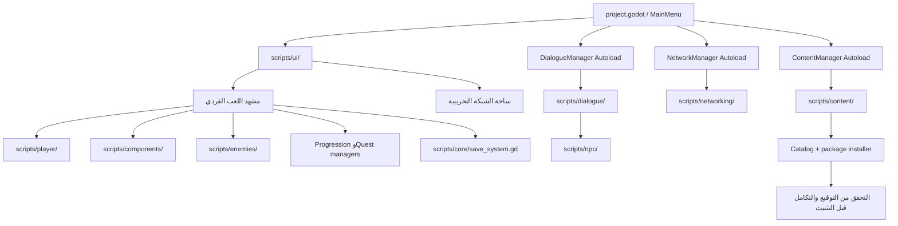
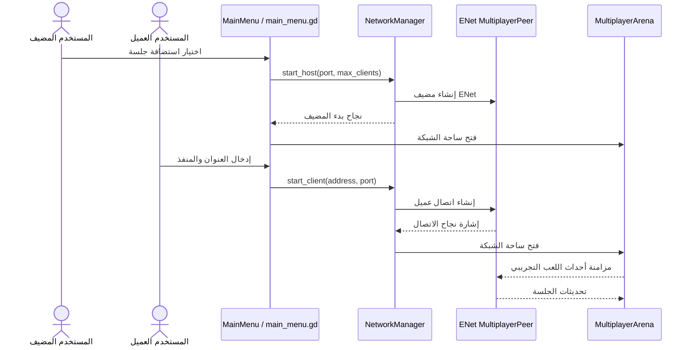
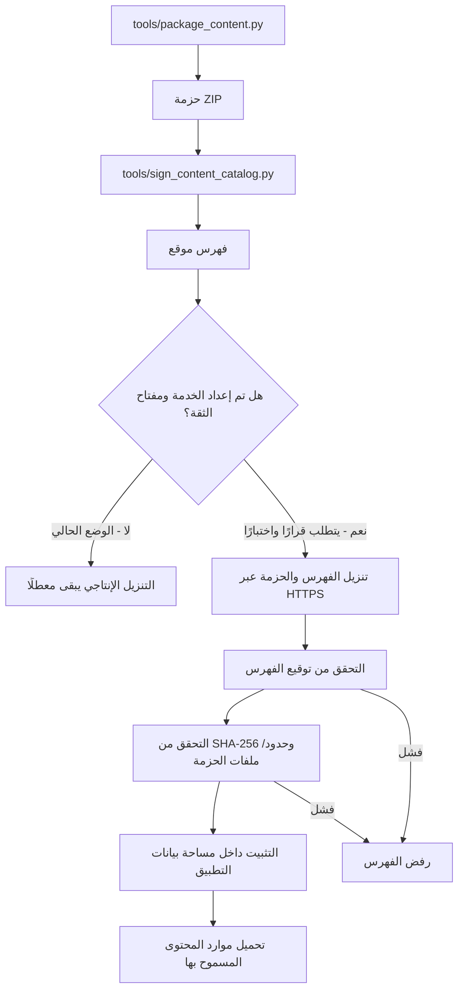
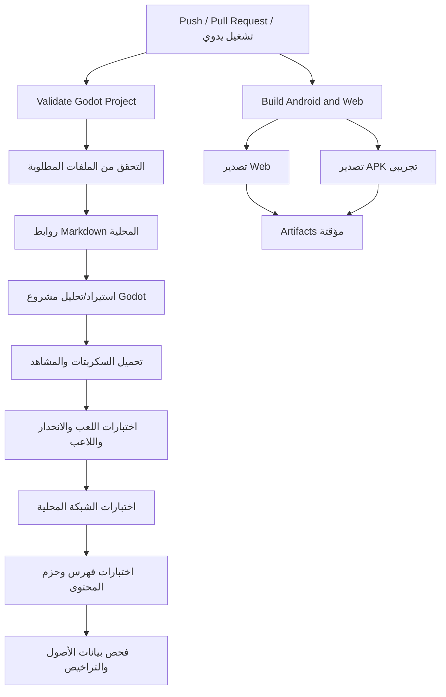

# مخططات ممالك الرماد

هذه المخططات مكتوبة بصيغة Mermaid كنص داخل Git، لتبقى قابلة للتعديل والمراجعة دون صور مولّدة أو ملفات ثنائية. تصف المخططات الحالية ما يمكن ربطه بمسارات المستودع؛ أما أي مسار مستقبلي فيُوسم بوضوح بأنه مقترح وغير منفذ.

> **المرجع التنفيذي:** [البنية التقنية](TECHNICAL_ARCHITECTURE.md)، [حالة التنفيذ](PROJECT_STATUS_AR.md)، [تدقيق المستودع](REPOSITORY_AUDIT_AR.md).

## 1. دخول اللعبة واختيار النمط — الوضع الحالي

**المسارات المصدرية:** يحدد `project.godot` مشهد القائمة نقطة البداية، وتنفذ `scripts/ui/main_menu.gd` اختيار اللعب الفردي أو إعداد جلسة ENet. يعتمد وضع الخادم headless على مسار القائمة الحالي. الملف `scripts/core/server.gd` ليس نقطة الدخول الفعلية لذلك المسار، وهو هيكل تمهيدي قديم.

## 2. طبقات الأنظمة — خريطة مبسطة

**ملاحظات:** هذا رسم ملاحة وتبعيات عالي المستوى، وليس مخطط UML كاملًا. التفاصيل الدقيقة لملكية الحالة والنداءات موجودة في السكربتات نفسها. لا يعني ظهور الوحدة في الرسم أن جميع ميزاتها مكتملة أو مفعّلة في كل منصة.

## 3. دورة جلسة ENet التجريبية — الوضع الحالي

### الحدود الأمنية الحالية

- الساحة نموذج اختبار وليست خدمة عامة جاهزة.
- لا توجد مصادقة حسابات إنتاجية أو حفظ شبكي دائم.
- لا تكتمل مزامنة الجرد والحوار والمهام المحلية مع الجلسة الشبكية.
- النجاح على loopback يثبت مسار الاتصال المختبر فقط، لا أمان الإنترنت ولا الأداء مع 100 لاعب.
- يجب التحقق من كل إجراء مؤثر على الخادم، لا الاعتماد على قيم الضرر أو المكافآت أو اكتمال المهمة القادمة من العميل.

راجع [NETWORKING.md](NETWORKING.md) لملاحظات التشغيل وحدود الشبكة وخطة التحقق.

## 4. دورة حزم المحتوى — كود أولي وضبط إنتاجي غير مكتمل

**تمييز مهم:** الكود الأولي وأدوات البناء والتحقق موجودة. إعداد فهرس إنتاجي مستضاف ومفتاح عام موثوق غير مكتمل، لذا تبقى واجهة التنزيل معطلة افتراضيًا. SHA-256 يكشف تغير المحتوى بالنسبة إلى قيمة مرجعية موثوقة، لكنه لا يحل محل التوقيع والتحقق من هوية مصدر الفهرس.

التفاصيل: [دليل حزم المحتوى](../content/README.md) و[مواصفة التصميم](superpowers/specs/2026-10-19-optional-content-packs-design.md).

## 5. التحقق والبناء — كيف نقرأ نتائج CI

يعكس هذا الرسم مجموعات الفحوص المعرفة في `.github/workflows/validate.yml` و`.github/workflows/build.yml`; راجع تعريف الـ workflow وسجل التشغيل للـ commit المعني. إذا تغير تسلسل CI فحدّث الرسم مع التغيير. لا تُسجّل نجاح خطوة إلا من سجلها الفعلي؛ نجاح التصدير ليس اختبار قبول لجهاز مادي.

## 6. مسار صيانة الوثائق — القاعدة المقترحة

```mermaid
flowchart LR
    CodeChange["تغيير الكود أو السلوك"] --> OwnerDoc["تحديث الوثيقة المالكة"]
    OwnerDoc --> Index["تحديث الروابط/الفهرس إذا لزم"]
    Index --> LinkCheck["tools/validate_docs.py"]
    LinkCheck --> AssetCheck["tools/validate_free_assets.py عند تغيير الأصول"]
    AssetCheck --> CI["نتائج CI مرتبطة بالـ commit"]
    CI --> Review["مراجعة القيود والأدلة"]
    Review --> Release["قبول الإصدار أو تسجيل العمل المتبقي"]
```

## قواعد تحديث المخططات

1. لا تنشئ مخططًا ثانيًا لنفس العملية؛ حدّث القسم المقابل.
2. يجب أن يشير كل مسار ملف إلى اسم موجود بالفعل أو يُوسم بأنه مقترح.
3. افصل في النص بين «الحالي» و«المستقبلي» و«لم يُختبر».
4. اجعل الرسم مختصرًا، واجعل تفاصيل البروتوكول والخوارزميات في الوثيقة المتخصصة.
5. شغّل `python3 tools/validate_docs.py` بعد تعديل الروابط. هذا الفحص يتحقق من وجود الأهداف المحلية، ولا يثبت صحة منطق الرسم أو الروابط الخارجية.
