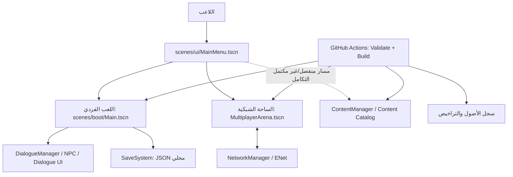
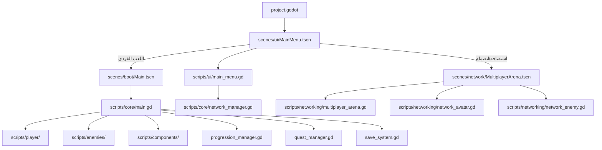
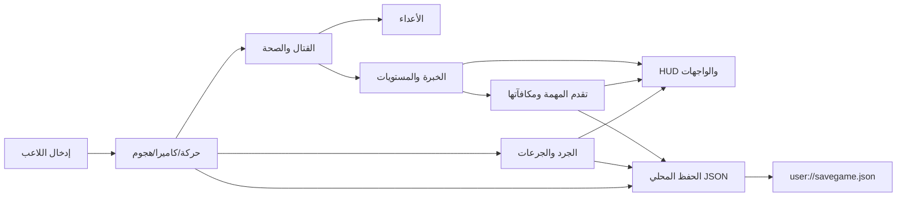
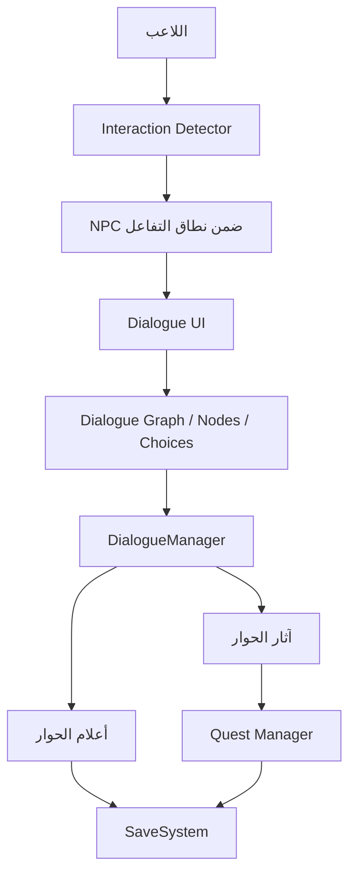
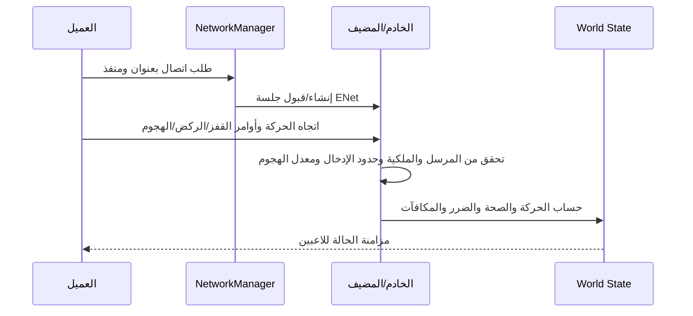
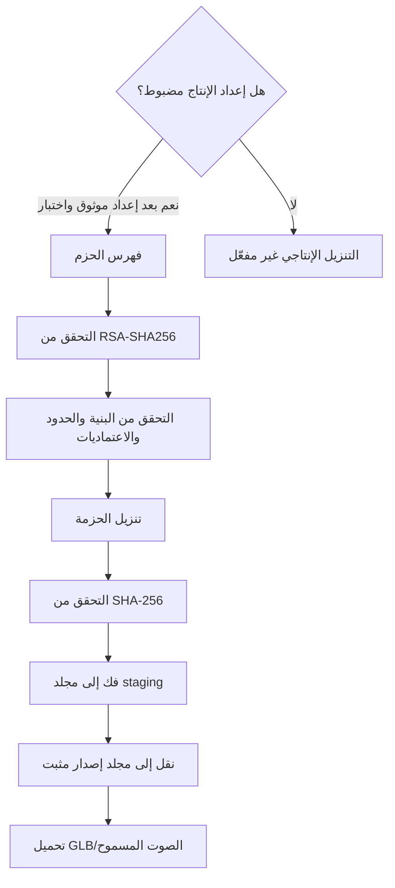
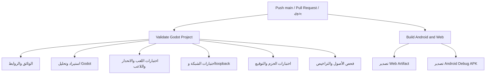

# مرجع المشروع الشامل — ممالك الرماد (AshenKingdoms)

> **الغرض:** نقطة مرجعية موحدة لفهم بنية المستودع، ومسارات التشغيل، والأنظمة، والاختبارات، ومخططات التدفق، والوثائق والمصادر الأصلية. هذه الوثيقة خريطة ربط وليست بديلًا عن الكود أو وثائق الأنظمة التفصيلية.
>
> **آخر تحديث تحريري:** 2026-10-19. الحالة الفعلية يجب التحقق منها على commit محدد ونتائج GitHub Actions المرتبطة به.

## 1. تعريف المشروع وحدوده

ممالك الرماد نموذج أولي للعبة تقمص أدوار فانتازيا ثلاثية الأبعاد باستخدام Godot 4.6 وGDScript. اتجاه التصميم هو الجمع بين RPG وفانتازيا باتل رويال، مع هدف طويل الأمد يصل إلى 100 لاعب في المباراة. **هذا الهدف المستقبلي ليس قدرة منفذة أو مثبتة حاليًا.** لا ينبغي اعتماد تصميم 100 لاعب قبل قياس الأداء واختبار التزامن والشبكة والسلطة الخادمية على بنية تشغيل واقعية.

### مصفوفة الحقيقة الحالية

| المجال | ما هو موثق حاليًا | ما لا يجوز افتراضه |
|---|---|---|
| اللعب الفردي | نموذج قابل للتشغيل يشمل الحركة والقتال والصحة والأعداء والجرد والخبرة والمستويات ومهمة تجريبية وحفظًا محليًا | جاهزية إنتاجية أو قبول يدوي شامل |
| الحوار وNPC | نظام حوار ومهمة محلي تجريبي | مزامنة الحوار والمهمات مع لاعبين متعددين |
| الشبكة | ساحة ENet تجريبية على Desktop/Android واختبارات loopback | مصادقة إنتاجية أو استضافة عامة آمنة أو حفظ شبكي دائم |
| Web | تصدير HTML5 للعب الفردي | دعم ENet أو لعب جماعي داخل المتصفح |
| Android | APK اختباري ARM64 من CI | توقيع إنتاجي أو نجاح اختبار على هاتف فعلي |
| حزم المحتوى | أساس برمجي لفهرس موقّع وتحقق وتثبيت | CDN أو فهرس إنتاجي أو تنزيل إنتاجي مفعّل |
| الأصول | سجل أصول وتراخيص وأدوات تحقق | اكتمال نموذج شخصية أو حزمة بيئات/صوتيات نهائية |
| 100 لاعب | هدف تصميم طويل الأمد | قدرة مقاسة أو ضمان أداء |

مصادر الحالة: [حالة التنفيذ](PROJECT_STATUS_AR.md)، [نطاق الإصدار](RELEASE_SCOPE_AR.md)، [البنية التقنية](TECHNICAL_ARCHITECTURE.md)، [الشبكة](NETWORKING.md).

## 2. مخطط السياق العام

**حدود مهمة:** اللعب الفردي والساحة الشبكية مساران منفصلان نسبيًا. لا تفترض أن الحفظ المحلي أو آثار الحوار أو الجرد الفردي أصبحت أنظمة شبكية لمجرد وجود ساحة ENet.

## 3. خريطة المستودع

| المسار | المسؤولية |
|---|---|
| `project.godot` | إعدادات مشروع Godot ونقطة البدء والـ Autoloads |
| `export_presets.cfg` | إعدادات تصدير المنصات |
| `scenes/boot/` | مشاهد بدء اللعب الفردي |
| `scenes/ui/` | القائمة الرئيسية، HUD، الحوار، اللمس ومكتبة المحتوى |
| `scenes/network/` | مشاهد اللاعبين والأعداء والساحة الشبكية |
| `scripts/core/` | تهيئة اللعب، التقدم، المهام، الحفظ، مدير الشبكة |
| `scripts/player/` | حركة اللاعب والكاميرا والهجوم والتفاعل |
| `scripts/enemies/` | منطق الأعداء |
| `scripts/components/` | مكونات قابلة لإعادة الاستخدام مثل الصحة والجرد |
| `scripts/dialogue/` و`scripts/npc/` | رسم الحوار وآثاره وتفاعل الشخصيات |
| `scripts/networking/` | منطق الساحة الشبكية واللاعبين والأعداء الشبكيين |
| `scripts/content/` | فهرس الحزم والتثبيت والإدارة وتحميل الأصول |
| `content/` | وصف حزم المحتوى وقواعدها |
| `assets/` | الأصول وسجلها وملفات إرشاد الشخصية |
| `addons/` | إضافات Godot الخاصة بسير الأصول والربط |
| `tests/` | اختبارات تحميل الموارد واللعب والانحدار والشبكة والمحتوى |
| `tools/` | أدوات التحقق والبناء والتوقيع والتشخيص |
| `.github/workflows/` | تعريفات التحقق والبناء الآلية |
| `docs/` | التوثيق المعماري والتشغيلي وخطط الإصدار والاختبار |
| `LICENSE` | رخصة الكود؛ لا تستبدل رخصة الكود رخص الأصول الخارجية |

## 4. خريطة المشاهد ومسارات البدء

- `scenes/ui/MainMenu.tscn` هي نقطة البدء المعروفة في المشروع.
- `scenes/boot/Main.tscn` مسار اللعب الفردي.
- `scenes/network/MultiplayerArena.tscn` ساحة منفصلة للتجارب الشبكية.
- `scripts/core/server.gd` موصوف كهيكل قديم تمهيدي؛ مسار تشغيل المضيف الحالي يمر عبر القائمة و`NetworkManager`.

## 5. تدفق اللعب الفردي

ملاحظات:
- مفاتيح التحكم والاختبارات التفصيلية موثقة في [README الرئيسي](../README.md) و[خطة الاختبار](TEST_PLAN.md).
- الحفظ المحلي لا يثبت حفظًا شبكيًا ولا ينبغي استخدام بيانات عميل كمرجع موثوق في اللعب الجماعي.
- بيانات الحفظ يجب أن تكون قيمًا بسيطة ومعرّفات؛ لا تخزّن موارد Godot مباشرة.

## 6. تدفق الحوار والمهمة

هذا المسار محلي وتجريبي. لا تمرر آثار الحوار أو المكافآت إلى الساحة الشبكية دون تصميم تحقق خادمي مستقل. راجع [البنية التقنية](TECHNICAL_ARCHITECTURE.md) و[خطة الاختبار](TEST_PLAN.md).

## 7. تدفق الشبكة التجريبية

- النقل الحالي: ENet/UDP، مناسب لمرحلة التجربة على المنصات المدعومة حاليًا، وليس للمتصفح في التصدير الحالي.
- الخادم مسؤول عن حساب الحركة والضرر والصحة والمكافآت في الساحة التجريبية وفق الوثائق الحالية.
- ما يزال مطلوبًا: مصادقة وهوية جلسة موثوقة، معالجة الانقطاع وإعادة الاتصال، حدود الموارد، مراقبة، حماية أوسع من الغش، واختبار فعلي بين أجهزة.
- **هدف 100 لاعب:** يتطلب تصميمًا منفصلًا للـ authoritative server، ومعدلات التحديث، وتصفية/تقسيم الرؤية، وميزانية الشبكة والذاكرة والمعالج، وقياسًا متكررًا قبل تحديد سعة مستهدفة.

راجع [وثيقة الشبكة](NETWORKING.md)؛ هي مرجع التفاصيل التشغيلية والتحذيرات.

## 8. حزم المحتوى الاختيارية

المكونات الموثقة:
- `scripts/content/content_catalog.gd`: التحقق من توقيع الفهرس وحدود المدخلات.
- `scripts/content/content_package_installer.gd`: تحقق البصمات وفك الحزم والتثبيت.
- `scripts/content/content_manager.gd`: إدارة الحالة والتنزيلات والتثبيت.
- `scripts/content/content_asset_loader.gd`: تحميل أصول من حزم مثبتة.
- `tools/package_content.py` و`tools/sign_content_catalog.py`: بناء الحزم وتوقيع الفهرس.
- `scenes/ui/ContentLibrary.tscn`: واجهة المكتبة.

**الوضع الحالي:** لا توجد خدمة توزيع إنتاجية أو مفتاح عام مضبوط؛ الميزة مؤجلة ومعطلة افتراضيًا. راجع [دليل المحتوى](../content/README.md) ومواصفات التصميم والخطة ضمن `docs/superpowers/`.

## 9. التحقق والبناء المستمران (CI)

المراجع التنفيذية هي ملفات workflow نفسها:
- [Validate Godot Project](../.github/workflows/validate.yml)
- [Build Android and Web](../.github/workflows/build.yml)

أسماء Artifacts الموثقة: `ashen-kingdoms-web` و`ashen-kingdoms-android-debug`. الاحتفاظ المعلن حاليًا 7 أيام. نجاح CI دليل على الخطوات المنفذة على commit محدد فقط؛ لا يثبت اختبار جهاز حقيقي أو جودة الشبكة العامة أو توقيع إصدار إنتاجي.

## 10. فهرس الوثائق والمراجع الداخلية

### البدء والقرارات
- [README الرئيسي](../README.md)
- [فهرس الوثائق](README.md)
- [حالة التنفيذ](PROJECT_STATUS_AR.md)
- [نطاق الإصدار وبوابات القبول](RELEASE_SCOPE_AR.md)
- [دليل صيانة الوثائق](DOCUMENTATION_GUIDE_AR.md)

### المعمارية والتشغيل
- [البنية التقنية التفصيلية](TECHNICAL_ARCHITECTURE.md)
- [ملخص البنية](ARCHITECTURE.md)
- [الشبكة وENet](NETWORKING.md)
- [بناء Android وWeb](BUILD_ANDROID_WEB_AR.md)
- [خطة الاختبار](TEST_PLAN.md)

### الأصول والأدوات
- [مسار الأصول المجانية](FREE_ASSET_PIPELINE_AR.md)
- [مسار توليد شخصية اللاعب](AI_PLAYER_CHARACTER_PIPELINE_AR.md)
- [تكامل الإضافات](PLUGIN_INTEGRATION_AR.md)
- [سجل الأصول والتراخيص](ASSET_CREDITS.md)
- [سجل الأصول الآلي](../assets/asset_manifest.json)
- [دليل أصول اللاعب](../assets/characters/player/README.md)

### المحتوى الاختياري
- [دليل حزم المحتوى](../content/README.md)
- [خطة حزم المحتوى](superpowers/plans/2026-10-19-optional-content-packs.md)
- [مواصفات تصميم الحزم](superpowers/specs/2026-10-19-optional-content-packs-design.md)

### الاختبارات والتشغيل الآلي
- [اختبار تحميل السكربتات والموارد](../tests/script_load_smoke_test.gd)
- [اختبار اللعب الأساسي](../tests/gameplay_smoke_test.gd)
- [اختبار انحدار اللعب](../tests/gameplay_regression_test.gd)
- [اختبار اللاعب](../tests/player_character_smoke_test.gd)
- [اختبار القتال الشبكي](../tests/network_combat_smoke_test.tscn)
- [اختبار عميل الشبكة](../tests/network_client_smoke_test.gd)
- [اختبار الحزم](../tests/content_catalog_smoke_test.gd)
- [أداة التحقق من الوثائق](../tools/validate_docs.py)
- [أداة التحقق من الأصول](../tools/validate_free_assets.py)

### تتبع قرارات الإصدار
- [Issue #20 — بوابة الإصدار](https://github.com/areagleegy/AshenKingdoms/issues/20)
- [Issue #21 — اللعب الجماعي في Web](https://github.com/areagleegy/AshenKingdoms/issues/21)
- [Issue #22 — الأصول المفتوحة الترخيص](https://github.com/areagleegy/AshenKingdoms/issues/22)

## 11. مراجع تقنية خارجية موصى بها

المراجع التالية هي مصادر رسمية أو أولية يُستحسن تثبيتها في مراجعات التصميم. راجع الإصدار الفعلي المستخدم قبل الترقية؛ لا تعتبر وجود رابط مرجع دليلًا على أن المشروع يعتمد كل تقنية فيه.

- [Godot Engine — الوثائق الرسمية](https://docs.godotengine.org/en/stable/)
- [Godot — تصدير مشاريع Web](https://docs.godotengine.org/en/stable/tutorials/export/exporting_for_web.html)
- [Godot — تصدير Android](https://docs.godotengine.org/en/stable/tutorials/export/exporting_for_android.html)
- [Godot — Multiplayer](https://docs.godotengine.org/en/stable/tutorials/networking/high_level_multiplayer.html)
- [Godot — ENetMultiplayerPeer](https://docs.godotengine.org/en/stable/classes/class_enetmultiplayerpeer.html)
- [Godot — MultiplayerSynchronizer](https://docs.godotengine.org/en/stable/classes/class_multiplayersynchronizer.html)
- [Godot — MultiplayerSpawner](https://docs.godotengine.org/en/stable/classes/class_multiplayerspawner.html)
- [GitHub Actions — الوثائق الرسمية](https://docs.github.com/en/actions)
- [OpenSSL — وثائق الأوامر](https://docs.openssl.org/)
- [Python — التوثيق الرسمي](https://docs.python.org/3/)

### سياسة المصادر والمراجع
1. الكود والمشاهد وملفات `.github/workflows/` هي مصدر الحقيقة للتنفيذ الحالي.
2. وثائق المشروع تشرح التنفيذ والقيود، لكنها قد تتأخر عن الكود؛ عند التعارض، افتح مهمة تصحيح وثائق.
3. مواصفات التصميم والخطط لا تعني أن الميزة نُفذت.
4. كل أصل خارجي يحتاج إلى مصدر أصلي ورخصة محددة وإسناد وشروط إعادة توزيع؛ رخصة MIT للمستودع لا تغطي تلقائيًا كل أصل.
5. لا تضف اعتماديات أو خدمات لمجرد أنها شائعة. وثّق سبب الحاجة، وصيانتها، وحجمها، ورخصتها، وتأثيرها الأمني والأدائي.
6. عند إضافة مخطط جديد، يجب أن يعكس أسماء الملفات ومسارات التنفيذ الموجودة، وأن يُحدّث ضمن PR نفسه الذي يغير النظام.

## 12. قائمة المراجعة قبل الإصدار

- [ ] فحص وثائق وروابط Markdown عبر `python3 tools/validate_docs.py`.
- [ ] فحص سجل الأصول والتراخيص عبر `python3 tools/validate_free_assets.py`.
- [ ] مراجعة نتائج workflow للتحقق والبناء على commit الإصدار.
- [ ] تثبيت APK على جهاز Android فعلي وتوثيق الجهاز والنتيجة.
- [ ] نشر Web عبر HTTP/HTTPS والتحقق من المتصفحات وأحجام العرض المستهدفة.
- [ ] عدم إعلان اللعب الجماعي في Web قبل تنفيذ ناقل متوافق واختباره.
- [ ] اختبار الشبكة بين أجهزة فعلية على الشبكة المستهدفة ومراجعة حدود الثقة.
- [ ] مراجعة الأصول الخارجية وحقوق الاستخدام والتعديل والتوزيع.
- [ ] إبقاء تنزيل المحتوى الإنتاجي معطلًا حتى تجهيز الخدمة والمفاتيح والإجراءات واختبارات الفشل.
- [ ] إبقاء هدف 100 لاعب ضمن نطاق التخطيط إلى أن تثبته اختبارات حمل قابلة للتكرار.

---
**قاعدة ختامية:** لا تساوِ بين «مخطط»، و«تنفيذ موجود»، و«اختبار آلي ناجح»، و«قبول على جهاز»، و«جاهزية إنتاجية». لكل مستوى دليل مختلف يجب ربطه بالـ commit والإصدار المقصودين.
