# المخططات التفصيلية لـ AshenKingdoms QA APK

> **نوع الوثيقة:** خريطة هندسية للمكوّنات وتدفقات البيانات والاختبارات والأمان.  
> **فرع المرجع:** `feature/android-qa-reporter`  
> **Commit التنفيذ الذي أثبت نجاح CI:** `f13c1eebef821286efc1509e5b5f55f694c3e1d9`  
> **تمييز إلزامي:** «الحالي» يعني ما تنفذه الملفات الموجودة في الفرع المشار إليه؛ و«مقترح» يعني توسعة لم تُنفذ بعد. لا تُعامل مخططات AI أو الرفع أو الوكلاء الكاملة على أنها وظائف موجودة في APK الحالي.

## 1. مفتاح حالة المخططات

| الرمز | المعنى |
|---|---|
| `[CURRENT]` | موجود في التنفيذ الحالي واجتاز فحص CI على commit المرجع |
| `[PARTIAL]` | موجود جزئيًا؛ لا يغطي الوظيفة الكاملة التي يوحي بها الاسم |
| `[PROPOSED]` | هدف معماري لم يُنفذ بعد |
| `[OUT OF SCOPE]` | ليس جزءًا من هذا الإصدار |

### الحالة الفعلية مقابل الهدف

| المكوّن | الحالة | السلوك الحالي أو الحد |
|---|---|---|
| preset منفصل `Android QA` وميزة `qa_tools` | CURRENT | حزمة Android منفصلة باسم `org.ashenkingdoms.game.qa` |
| QAReporter | CURRENT | أحداث مقيّدة، عينات أداء، نقاط تحقق محلية، وتصدير JSON |
| QATestRunner | PARTIAL | يتحقق من تحميل مشاهد محددة وقراءة/كتابة ملف مؤقت؛ لا يلعب سيناريوهات كاملة |
| زر تشغيل الفحص ونسخ التقرير | CURRENT | الفحص والتصدير يتمان عند ضغط المختبِر؛ النسخ عبر Clipboard |
| أحداث حفظ وشبكة | PARTIAL | أحداث منظمة محدودة، دون سجل Android العام أو بيانات كل RPC |
| Navigator / Combat Stress / Network Fault Agents | PROPOSED | ليست وكلاء لعب كاملة في APK الحالي |
| Seed وReplay حتمي | PROPOSED | لا يوجد مسجل إعادة تشغيل كامل حاليًا |
| رفع التقرير من APK إلى Backend | OUT OF SCOPE | لا توجد قناة رفع في APK الحالي |
| AI داخل APK أو مفتاح API داخله | OUT OF SCOPE | لا نموذج محلي ولا مفاتيح AI/GitHub داخل الحزمة |
| تحليل خارجي متعدد الوكلاء وإنشاء PR | PROPOSED | يجب أن يكون خارج APK وبصلاحيات منفصلة ومراجعة بشرية |
| منع وجود QA في Release | هدف أمني | توجد حدود تصدير منفصلة؛ يلزم فحص artifact إنتاجي نهائي كخطوة مستقلة |

---

## 2. المخطط السياقي للنظام

يوضح المخطط ما هو موجود اليوم وما يمكن إضافته لاحقًا. المسار المتصل المحلي هو الموجود حاليًا؛ المسارات ذات العلامة `PROPOSED` ليست تنفيذًا حاليًا.

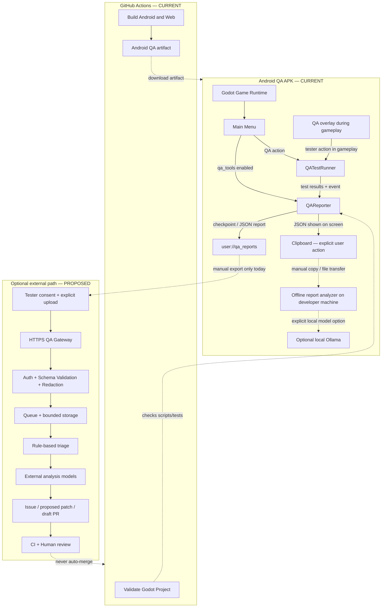

**قراءة المخطط:** وجود ملف تقرير محلي لا يعني وجود Upload API. في النسخة الحالية لا يغادر JSON الجهاز تلقائيًا. كما أن نجاح CI يثبت اجتياز الاختبارات الآلية المحددة فقط، وليس اختبارًا على هاتف حقيقي.

## 3. حدود البناء والتغليف

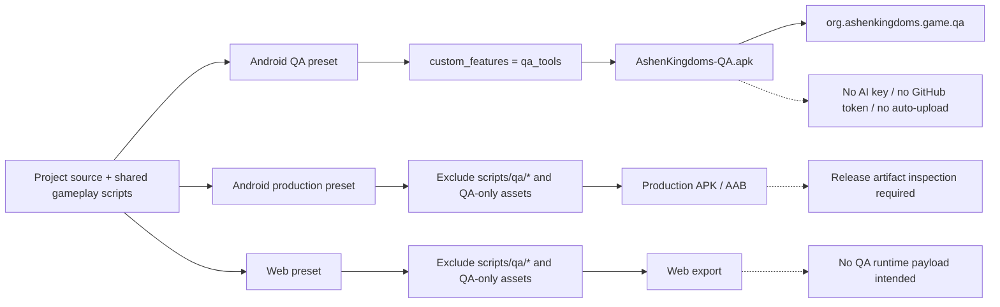

### حدود هذا الفصل

- يعتمد ظهور أدوات QA على feature tag المخصص `qa_tools` وليس على إخفاء زر فقط.
- يوجه preset الخاص بـ QA إلى package ID منفصل حتى لا يحل محل النسخة العادية.
- يستبعد التصديران الاعتياديان ملفات `scripts/qa/*` وفق إعدادات التصدير في الفرع.
- لا تكفي إعدادات preset وحدها كدليل نهائي على خلو Release: يلزم فحص الحزمة المبنية نفسها، وفحص manifest والمراجع والموارد والأسرار بعد التصدير.
- لا يوضع سر AI أو رمز GitHub في source أو APK أو ملف تقرير.

## 4. خريطة الملفات الفعلية والمقترحة

### الملفات الأساسية الموجودة الآن

```text
project.godot
export_presets.cfg
scripts/
├── core/
│   ├── save_system.gd                 # أحداث حفظ منظمة محدودة
│   └── network_manager.gd             # أحداث جلسة ENet محدودة
├── ui/
│   └── main_menu.gd                   # تهيئة QA وواجهة الفحص والنسخ
└── qa/
    ├── qa_reporter.gd                 # تجميع الحدث والأداء والحفظ المحلي
    └── qa_test_runner.gd              # تحميل موارد + اختبار التخزين
tests/
└── qa_reporter_smoke_test.gd           # 10 assertions في الفحص الحالي
.github/workflows/
├── build.yml                          # Android QA + Android debug + Web
└── validate.yml                       # تحقق Godot واختبار QAReporter
docs/
└── QA_ANDROID_REPORTER_AR.md
```

### التوسعات المقترحة — لا تُعد ملفات موجودة الآن

```text
scripts/qa/
├── qa_config.gd
├── qa_orchestrator.gd
├── qa_session.gd
├── scenario_registry.gd
├── action_executor.gd
├── replay_recorder.gd
├── agents/
│   ├── qa_agent_base.gd
│   ├── navigator_agent.gd
│   ├── combat_stress_agent.gd
│   ├── save_load_agent.gd
│   ├── network_fault_agent.gd
│   ├── performance_agent.gd
│   └── supervisor_agent.gd
├── metrics/
│   ├── frame_metrics.gd
│   ├── gameplay_metrics.gd
│   └── memory_metrics.gd
├── evidence/
│   ├── evidence_collector.gd
│   ├── state_snapshot.gd
│   └── report_writer.gd
├── transport/
│   ├── report_transport.gd
│   ├── local_transport.gd
│   └── https_transport.gd
└── ui/
    ├── qa_overlay.gd
    └── qa_menu.gd
```

أضف هذه الطبقات تدريجيًا بعد تثبيت التقرير المحلي واختباره على هاتف حقيقي؛ لا تنشئ كل الملفات كواجهات فارغة دفعة واحدة.

## 5. دورة بدء التطبيق وتشغيل فحص QA — CURRENT

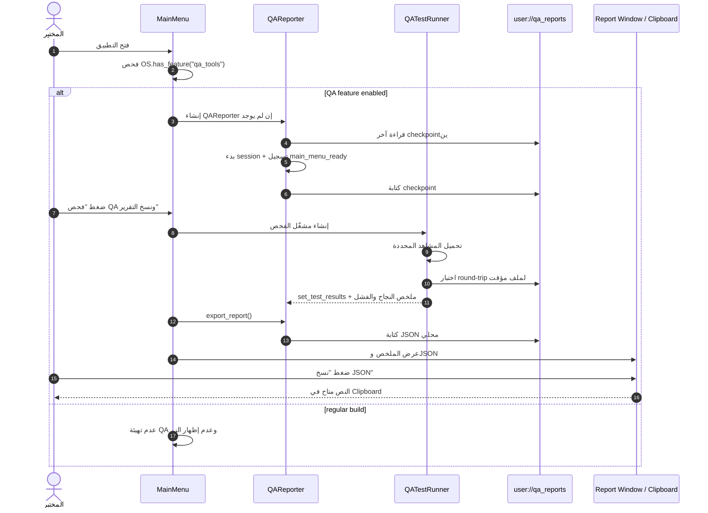

### الفحوص التي ينفذها QATestRunner الآن

| معرف الاختبار | ما يتحقق منه | ما لا يثبته |
|---|---|---|
| `main_scene_load` | وجود وتحميل PackedScene للمشهد الرئيسي | أن كل آليات اللعب تعمل |
| `multiplayer_arena_load` | تحميل مشهد الساحة | أن الاتصال الخارجي أو اللعب بين هاتفين صالح |
| `touch_controls_load` | تحميل مورد واجهة اللمس | صحة لمس كل جهاز أو اتجاه شاشة |
| `network_avatar_load` | تحميل مورد شخصية الشبكة | صحة كل حالات المزامنة |
| `network_enemy_load` | تحميل مورد عدو الشبكة | صحة الذكاء الاصطناعي للعدو أو القتال الكامل |
| `storage_roundtrip` | إنشاء مجلد QA وكتابة/قراءة/حذف ملف اختبار | سلامة نظام الحفظ الفعلي في كل حالات الانقطاع |

**حد أساسي:** هذه فحوص موارد وتخزين، لا وكيل يتنقل في العالم أو يقاتل بشكل ذاتي.

## 6. دورة حياة الجلسة — CURRENT + TARGET

الحالة الحالية هي دورة جمع حدث وقياس وحفظ محلي. حالات الاسترداد والتنفيذ متعدد السيناريوهات هدف مقترح للموسعات القادمة.

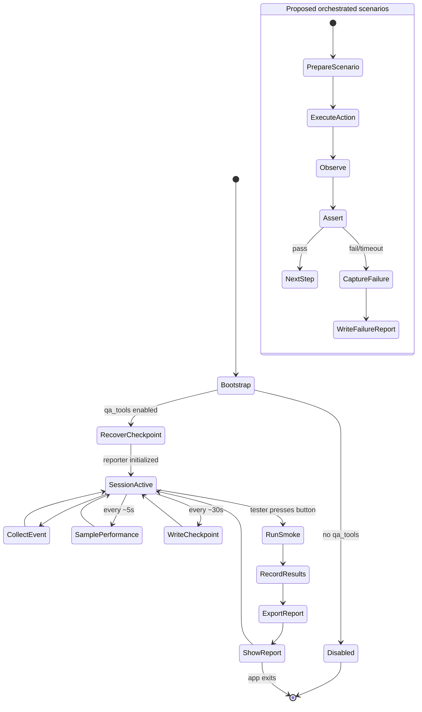

### حدود زمنية وتخزين موثقة في التنفيذ الحالي

| الحد | القيمة الحالية |
|---|---:|
| الحد الأقصى للأحداث في الذاكرة لكل تقرير | 300 حدث |
| تكرار أخذ عينات الأداء | نحو 5 ثوانٍ |
| دورية checkpoint | نحو 30 ثانية |
| عدد ملفات checkpoint | ملفان بالتناوب |
| أقصى حجم checkpoint مقروء | 512 KiB |
| عدد الجلسات السابقة المسترجعة | 3 |
| الإبلاغ/الرفع التلقائي | معطل؛ لا يوجد مسار Upload في APK |
| بيانات حرّة داخل تفاصيل الحدث | تُستبعد؛ تقبل المفاتيح الآمنة والقيم الرقمية/المنطقية فقط |

لا تضمن checkpoint كل حدث على القرص في لحظته؛ لذلك قد تضيع أحداث بعد آخر نقطة مكتوبة عند انهيار مفاجئ.

## 7. المعمارية المستهدفة للـ Orchestrator والوكلاء — PROPOSED

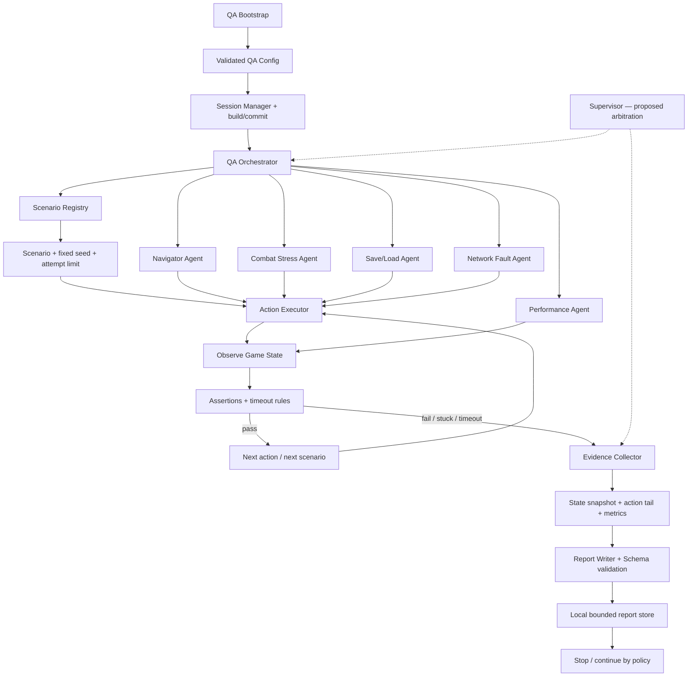

### عقد الوكيل المقترح

كل وكيل جديد يجب أن يعرّف على الأقل:

```text
agent_id
supported_scenarios
preconditions
actions
observations
assertions
per_action_timeout
scenario_timeout
max_retries
recovery_policy
evidence_policy
cleanup
result_status
```

ويجب أن يكون لكل وكيل نطاق أفعال محدد. لا تسمح لوكيل الشبكة بتغيير ملفات حفظ حقيقية، ولا لوكيل الأداء بتشغيل اختبارات تغير الجرد أثناء قياس خط أساس الأداء.

## 8. مخطط الوكلاء وتغطية السيناريوهات — TARGET

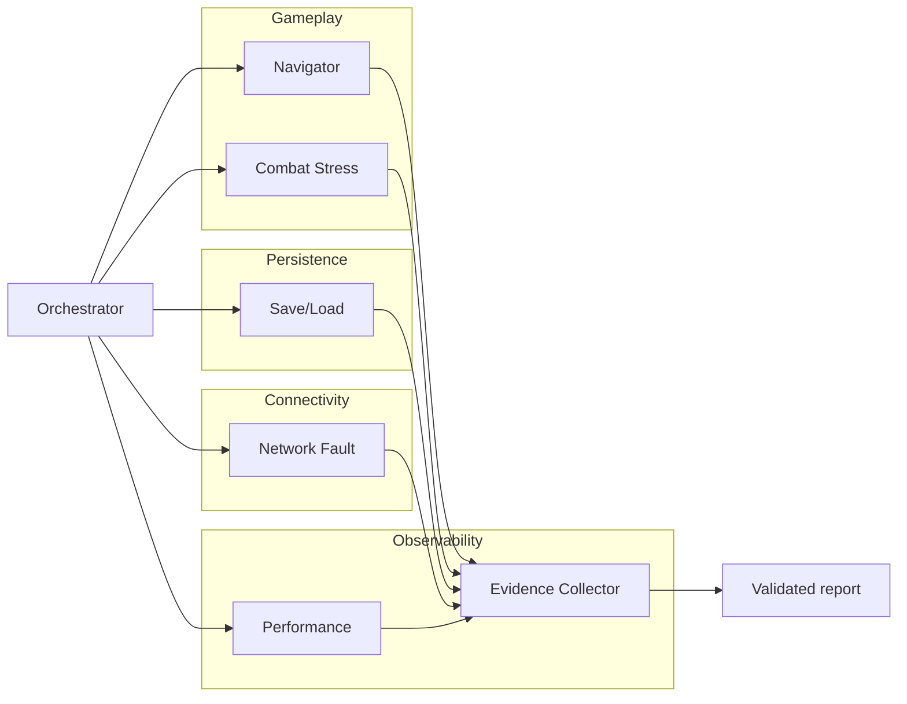

| الوكيل المقترح | سيناريوهات نموذجية | شرط فشل قابل للقياس |
|---|---|---|
| Navigator | حركة، اصطدام، جدار، حافة، مسار مسدود | عدم تغير الموضع خارج هامش متفق عليه طوال مهلة الحركة |
| Combat Stress | هجوم/مراوغة/مهارة، تبريد، عدة أعداء | ضرر خارج المتوقع، مهلة لا تنتهي، موت أو حالة غير صالحة |
| Save/Load | تعديل حالة fixture، حفظ، إعادة تحميل، مقارنة snapshot | فرق حتمي في الحقول المتوقعة أو JSON غير قابل للقراءة |
| Network Fault | فصل، مهلة اتصال، رسالة مكررة، RPC غير صالح | crash أو تغيير حالة خادم غير مصرح أو غياب نتيجة متوقعة |
| Performance | مشهد وخطوات ثابتة، قياسات إطارات | تجاوز خط أساس مضبوط على جهاز/محرك/مشهد مطابق |
| Evidence | تلخيص حالة الفشل وسجل الأفعال | تقرير ناقص، كبير جدًا، أو يحتوي على حقل محظور |

لا يعدّل الوكيل الشيفرة. ينتج أدلة قابلة للتكرار؛ التنفيذ والاختبار يظلان منفصلين عن أي اقتراح AI لاحق.

## 9. مخطط تقرير JSON — الموجود والمستهدف

### الحقول الموجودة الآن

تحتوي بنية التقرير الحالية على:

```text
schema_version
report_type
generated_at
checkpoint_unix
session_id
session_started_at
session_duration_seconds
build:
  commit
  project_name
  project_version
  godot_version
  os_name
  android
  qa_tools
  debug_build
current_scene
performance:
  sample_count
  average_fps
  minimum_fps
  maximum_fps
  peak_static_memory_mb
test_results[]
events[]
previous_sessions[]
safety:
  local_only
  automatic_upload
  ai_requests_from_apk
  raw_dialogue_or_chat_recorded
  save_contents_recorded
  network_addresses_recorded
  event_limit
```

### الإضافات المقترحة فقط

حقول `device_hash` و`android_api` و`renderer` و`scenario_id` و`seed` و`replay_id` و`artifacts[]` لا ينبغي الإيحاء بأنها موجودة في التقرير الحالي؛ تضاف بعد تصميم خصوصية واختبارات مخطط مستقلة.

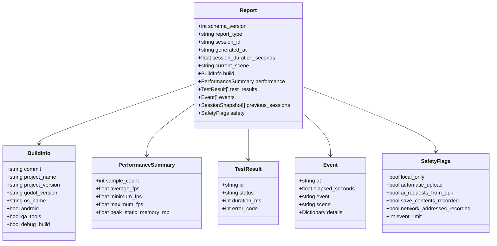

### ضوابط المخطط

- `schema_version` إلزامي لكل نسخة مستقبلية من التقرير.
- `status` في نتائج الاختبارات يقتصر على `pass` و`fail` و`skip`.
- `event` اسم منظم قصير؛ لا تستخدمه لتخزين stack trace أو نص الحوار.
- تفاصيل الحدث الحالية ترفض النصوص الحرة، وتقبل قيمًا رقمية/منطقية من مفاتيح مطابقة للنمط المسموح.
- يجب أن يكون كل تطور غير متوافق في بنية التقرير مصحوبًا بتحديث اختبارات schema وأداة التحقق.

## 10. تخزين محلي ونقاط تحقق — CURRENT

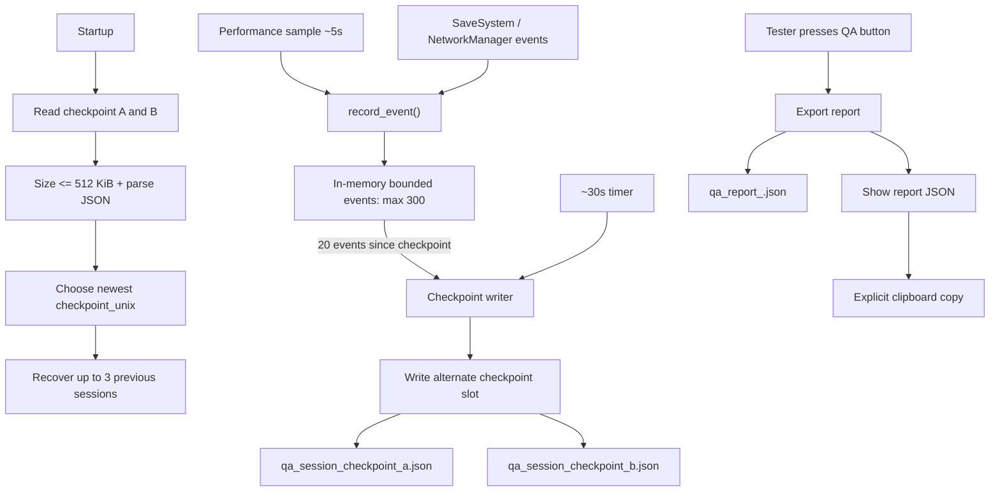

### متطلبات التخزين المستهدفة

| العنصر | التوصية المستقبلية |
|---|---|
| التقرير المؤقت | الكتابة إلى ملف مؤقت ثم إعادة تسمية بعد النجاح |
| حجم كل تقرير | حد مقترح 256 KiB؛ لا يزال يحتاج تطبيقًا واختبارًا |
| عدد التقارير غير المرفوعة | حد مقترح 20 تقريرًا |
| المرفقات | حد مقترح 5 مرفقات، مع screenshots اختيارية عند الفشل فقط |
| التنظيف | تدوير مضبوط يحتفظ بآخر التقارير الفاشلة وملخصاتها |
| فشل التخزين | تسجيل حدث مختصر ثم استمرار اللعبة؛ لا crash بسبب QA |
| تعطل الجهاز | لا وعد باسترجاع الأحداث الأحدث من checkpoint آخر ناجح |

الحدود في الجدول المستهدف لا تدخل كلها في التنفيذ الحالي تلقائيًا؛ يجب تنفيذ كل حد واختباره قبل وصفه بأنه ضمان قائم.

## 11. إرسال خارجي وتحليل AI — PROPOSED ONLY

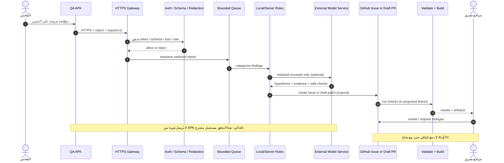

### عقد الواجهة المقترح

```http
POST /v1/qa/reports
Content-Type: application/json
X-QA-Build-ID: <build-id>
X-QA-Request-ID: <uuid>
Authorization: <short-lived QA credential>
```

- يجب أن تنفذ الخدمة المصادقة وتحقق الحجم والمخطط ومعدل الطلب قبل تخزين التقرير.
- يتم التنقيح عند العميل وعند Gateway؛ التنقيح المزدوج ليس بديلًا عن حظر حقول حساسة أصلًا.
- أسرار المزود تحفظ في Secret Manager/GitHub Secrets، ولا ترجع إلى APK.
- تخضع أي بيانات مرسلة خارجيًا لموافقة المختبِر وسياسة الاحتفاظ وخصوصية المزوّد.
- إذا كانت نقطة النهاية غير آمنة أو فشل الرفع، يبقى التقرير محليًا؛ لا يعطل ذلك اللعب.
- GitHub Models ليس أساسًا مفترضًا لهذا التصميم؛ اختر مزوّدًا حاليًا موثّقًا وأعد التحقق من سياساته وحدوده عند التنفيذ.

## 12. مناطق الثقة والأمان

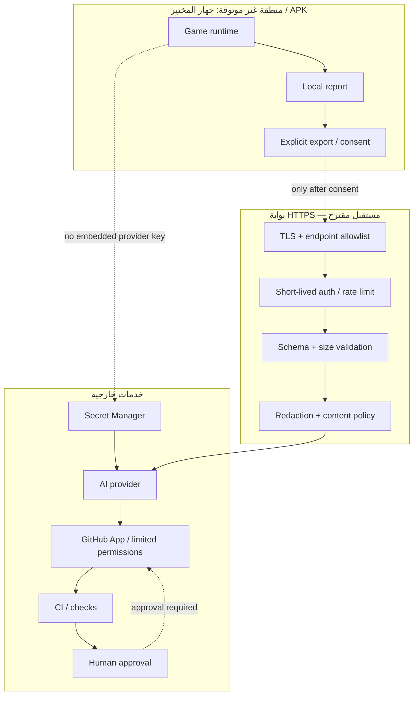

### قواعد أمنية غير قابلة للتفاوض

1. **لا مفاتيح AI أو GitHub داخل APK.** أي قيمة مدرجة في حزمة عميل تعتبر قابلة للاستخراج.
2. التقارير لا تحتوي على save-file body، نصوص الحوارات، إدخال المستخدم الخام، عناوين الشبكة، أو أسرار.
3. لا يقبل Gateway تقريرًا لمجرد احتوائه على `commit`؛ يتحقق من الحجم والمخطط والمصادقة والحصة.
4. لا يحصل وكيل التحليل على صلاحية تعديل `main` أو دمج PR.
5. أي patch مقترح يمر باختبارات تلقائية ومراجعة بشرية.
6. لا تنشأ جلسة تصوير أو تسجيل مستمر خفي؛ الأثر الإضافي محدود ومقصود ومُعطّل افتراضيًا.
7. تُسجل حالة «لم تُلتقط أدلة كافية» بدل الاستنتاج بأن اللعبة سليمة.

## 13. مخطط CI وRelease Guard

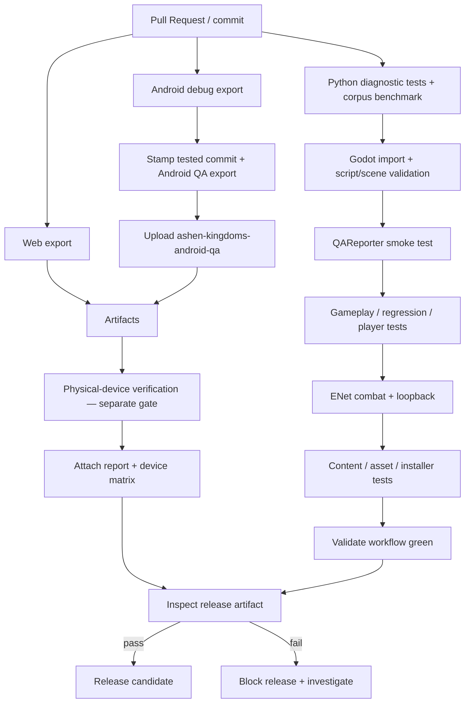

### Release Guard المقترح

| الفحص | دليل النجاح المطلوب |
|---|---|
| لا scripts/qa | فحص محتويات export/pack النهائي، وليس اعتمادًا على preset فقط |
| لا QA overlay / menu | بحث الموارد والنصوص والمراجع في الحزمة |
| لا أسرار | secret scan للمصدر ولملفات APK المستخرجة |
| package identity صحيح | تحقق manifest وapplication ID |
| build provenance | commit كامل ومحدد وworkflow ناجح |
| schema / tests | اختبارات schema والانحدار ناجحة |
| جهاز حقيقي | تقرير مثبت على commit والبناء والطراز وإصدار Android |
| بوابة الدمج | نجاح CI ومراجعة بشرية؛ لا دمج تلقائي |

**لا يثبت Build Android and Web وحده** أن APK قد شُغّل على هاتف حقيقي، كما أن نجاح Export لا يثبت سلوك اللمس أو الحرارة أو انقطاع الطاقة.

## 14. مصفوفة سيناريوهات الاختبار

جميع المعرفات التالية ما عدا فحوص الموارد والتخزين الحالية هي سيناريوهات مستهدفة، وتحتاج تنفيذًا واختبارًا منفصلين.

| الفئة | المعرف | الإجراء | النتيجة القابلة للتحقق |
|---|---|---|---|
| Smoke | S001 | boot + main scene | لا crash + المشهد المتوقع |
| Smoke | S002 | enter world | العالم ظاهر وplayer node موجود |
| Movement | S003 | تحرك نحو waypoint | تغير الموضع داخل مهلة محددة |
| Combat | S004 | attack مرة واحدة | HP/حدث الضرر يطابق التوقع |
| Dialogue | S005 | فتح/اختيار حوار | flag وحالة الاختيار متوقعان |
| Quest | S006 | تتبع/تحديث مهمة | انتقال الحالة مرة واحدة |
| Save | S007 | حفظ fixture | الملف قابل للقراءة والحقول المطابقة |
| Reload | S008 | إعادة تحميل | snapshot المتوقع يطابق الفعلي |
| Regression | S101 | inventory cycle | العناصر والكميات صحيحة |
| Regression | S102 | player death/respawn | انتقال حالات الموت والظهور مضبوط |
| Regression | S103 | enemy reward twice | مكافأة واحدة فقط |
| Persistence | S105 | JSON تالِف | رفض آمن دون crash أو استبدال بيانات سليمة |
| Boundary | S106 | اصطدام/حافة | لا خروج غير مصرح من العالم |
| Stress | S201 | attack/dodge/skill بالتتابع | لا soft lock ولا زمن انتظار مكسور |
| Stress | S204 | فتح/إغلاق inventory | حالة UI متسقة |
| Network | S301 | ENet host loopback | اتصال محلي ونتيجة واضحة |
| Network | S303 | disconnect | حدث انقطاع وحالة جلسة معروفة |
| Network | S305 | invalid RPC | رفض آمن وعدم تغيير حالة غير مصرح |
| Network | S306 | request flood | تحديد معدل موثّق دون crash |

### شرط إعادة الإنتاج

لكل سيناريو آلي مستقبلي يجب تسجيل `scenario_id` و`seed` و`attempt` ونسخة البناء والـ commit، ثم تقييد الأفعال والمهلات وعدد المحاولات. لا تعتبر تكرار الاختبار «إعادة إنتاج» إذا تغير البناء أو الجهاز أو الإعدادات دون توثيق ذلك.

## 15. مقاييس الأداء وخطة القياس

### مقاييس موجودة الآن

- متوسط FPS محسوب على عينات غير صفرية.
- أدنى وأعلى FPS ضمن العينات.
- ذروة الذاكرة الساكنة التي يقيسها Godot.
- أزمنة processing/physics في أحداث عينات دورية.

### مقاييس مستهدفة لم تُطبق بعد

```text
frame_time_ms
p50_frame_ms
p95_frame_ms
p99_frame_ms
max_frame_ms
physics_time_ms
startup_ms
scene_load_ms
scenario_duration_ms
action_count
error_count
thermal_state          # إذا توفر مصدر موثوق على الجهاز
android_memory_bytes   # يتطلب مصدر Android موثقًا
```

لا تحدد عتبة أداء عامة قبل جمع خط أساس على أجهزة مستهدفة متفق عليها. قارن فقط نتائج لها نفس build، والجهاز/فئته، وإصدار Android، والـ renderer، والمشهد والسيناريو. شغّل profiler الثقيل في جلسات تشخيص منفصلة إذا أثّر في القياس.

## 16. خطة التنفيذ ذات بوابات قبول

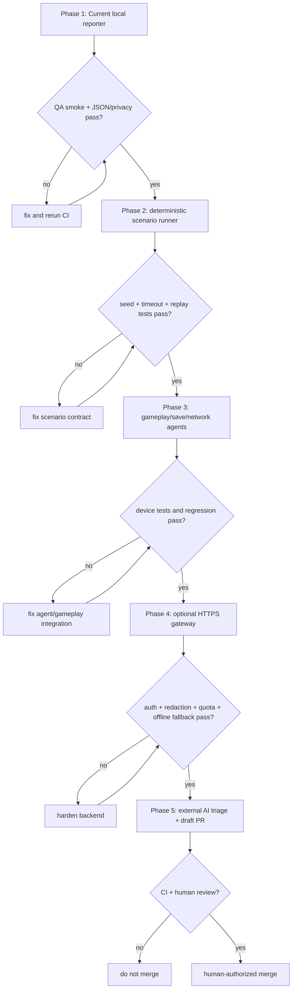

### تعريف اكتمال كل مرحلة

| المرحلة | دليل القبول |
|---|---|
| P1 المحلي | Godot smoke، JSON صالح، تنقية، حدود أحداث، فشل التخزين آمن، اختبار جهاز يدوي |
| P2 السيناريوهات | seed يعيد نفس تسلسل الأفعال، timeout لكل فعل وسيناريو، cleanup بعد الفشل |
| P3 وكلاء اللعب | fixtures، assertions صريحة، حالات نجاح/فشل، تقرير لكل سيناريو |
| P4 النقل | موافقة صريحة، HTTPS، مصادقة محدودة، schema validation، redaction، offline queue bounded |
| P5 التحليل | أدلة مرتبطة بالـ commit، افتراضات موسومة، patch مقترح، CI أخضر ومراجعة بشرية |

## 17. أمور يجب ألا تستنتجها من المخططات

- نجاح CI لا يعني تجربة على هاتف حقيقي.
- `storage_roundtrip` ليس اختبار crash-consistency ولا يثبت مقاومة فقد الطاقة.
- تحميل مشهد لا يثبت أن القتال أو اللمس أو AI للعدو يعمل.
- ENet loopback لا يثبت سلامة اتصال الإنترنت أو خادم عام.
- قياسات Godot لا تمثل كامل استهلاك Android/thermal behavior.
- التقرير المحلي ليس رفعًا إلى AI.
- نموذج AI لا يعرف إلا الدليل المرسل له ولا ينفذ إصلاحًا موثوقًا بذاته.
- إنشاء draft PR ليس دليل صحة؛ يجب تنفيذ الاختبارات ومراجعة الفروق.
- لا تذكر سعة «100 لاعب» أو جاهزية multiplayer الإنتاجي بلا اختبار حمل مستقل على البنية الحقيقية.

## 18. مراجع التنفيذ داخل المستودع

- `scripts/qa/qa_reporter.gd` — الحدث، الأداء، checkpoints، JSON.
- `scripts/qa/qa_test_runner.gd` — فحوص موارد وتخزين أساسية.
- `scripts/ui/main_menu.gd` — تهيئة QA وزر الفحص وعرض/نسخ التقرير.
- `scripts/core/save_system.gd` — أحداث محلية لعمليات الحفظ.
- `scripts/core/network_manager.gd` — أحداث محدودة لحالة جلسة ENet.
- `tests/qa_reporter_smoke_test.gd` — اختبارات التنقية والحدود والتصدير.
- `.github/workflows/validate.yml` — اختبارات Godot والتحقق الآلي.
- `.github/workflows/build.yml` — تصدير Android QA وAndroid debug وWeb.
- `docs/QA_ANDROID_REPORTER_AR.md` — خطوات استخدام QA على الجهاز.

راجع الملفات ونتائج CI على نفس commit قبل استخدام هذا المخطط كوثيقة اعتماد.
